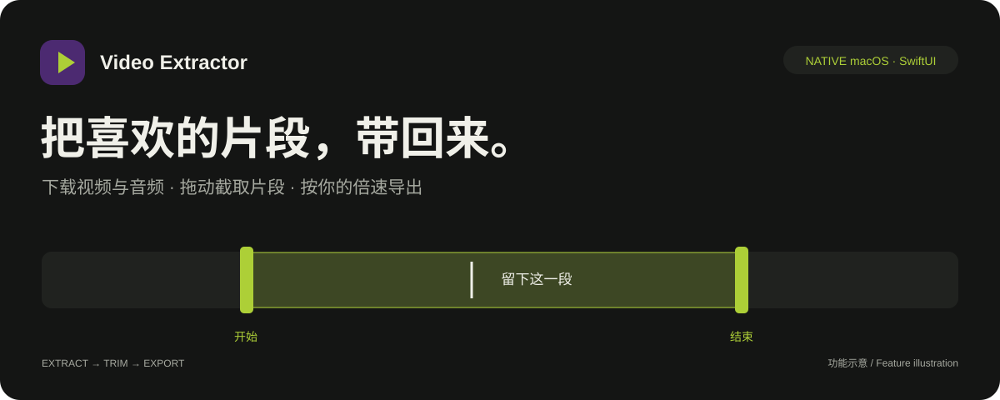
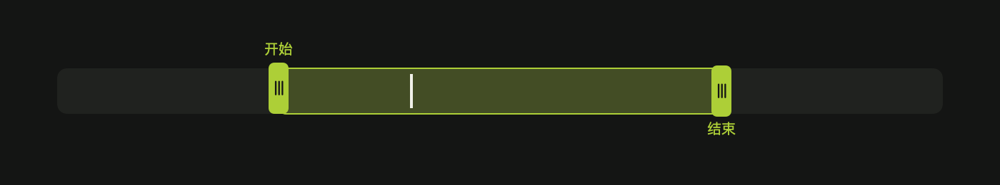

<p align="center">
  
</p>

<p align="center">
  <strong>从一个链接，到一段值得留下的视频。</strong><br>
  为 macOS 制作的原生影音工具：下载、预览、截取，在一个应用中完成。
</p>

<p align="center">
  <a href="#功能">功能</a> ·
  <a href="#开始使用">开始使用</a> ·
  <a href="#构建与验证">构建与验证</a> ·
  <a href="Shouxia/README.md">详细说明</a>
</p>

## 下载 Mac 原版

**[下载 Mac 原版安装包](https://github.com/yingfelix311-crypto/video-extractor/releases/tag/native-v1.0.0)** · **[安装与后台配置说明](docs/INSTALL-MAC.md)**

| 版本 | 系统 | 状态 |
| :--- | :--- | :--- |
| Mac 原版 1.0.0 | Apple Silicon · macOS 14+ | 私有测试发行包，保留现有 SwiftUI / AVFoundation / MeTube 实现 |

仓库保持私有，需使用拥有仓库读取权限的 GitHub 账号下载。请下载 Releases 中的 **Video-Extractor-Native-1.0.0-macOS-arm64.zip**，而不是 Source code ZIP。完整解压后使用「安装原版.command」准备原版后台环境。

**当前只提供 Mac 原版，不提供 Windows 版。**此前独立 Electron 客户端已停用，不属于原版发行。此次没有替换界面、交互、下载参数或剪辑实现。

安装包未 Apple 公证，首次安装需要联网。干净 Mac 的完整首次配置仍需真实环境验收，具体限制见安装说明。

## 功能

| 从这里开始 | 你可以做什么 |
| :--- | :--- |
| **粘贴链接，带回视频** | 提取视频或 MP3 音频，选择画质，查看真实下载进度。 |
| **拖动两端，留下片段** | 打开已下载或本地视频，拖动时间线的开始、结束节点；高亮区域就是导出范围。 |
| **按自己的节奏播放** | 播放／暂停一键切换，支持常用倍速及 **0.25–2×** 自定义倍速。 |
| **预览确认，变速导出** | 导出采用点击导出时的倍速，画面与音频同步变速，保存为新的 MP4，保留原文件。 |
| **文件放在顺手的地方** | 自选保存目录、打开文件、在 Finder 中定位；保存失败可更换位置并重试。 |
| **需要时，随手打开** | 菜单栏粽子入口与 Spotlight 风格快捷输入框；下载引擎在空闲时自动检查更新。 |

深色底、紫色标识、黄绿色操作按钮，搭配 Sora / Manrope 字体。界面保持统一，让操作集中在视频本身。

### 片段截取



*实际组件渲染示例：双节点选择范围，白线显示当前播放位置。*

1. 点击已完成视频旁的 **剪刀**，或选择 **文件 → 截取本地视频…**（`⇧⌘K`）。
2. 拖动开始、结束节点选择范围；也可输入时间，精确到毫秒。
3. 选择播放倍速，点击 **预览片段** 核对。
4. 点击 **导出片段**，选择保存位置。

**例如：** 选中原视频的 10 秒，选择 `2×`，导出约为 5 秒；选择 `0.5×`，导出约为 20 秒。界面会显示预计导出时长。每次导出一个片段，支持取消，已有同名文件不会被覆盖。

## 开始使用

### 环境要求

- **Apple Silicon Mac · macOS 14+**。
- Apple Command Line Tools，用于本地构建。
- 下载功能依赖已经配置好的 **Colima / Docker / MeTube**：`metube` profile、`metube` 容器、`127.0.0.1:8081`，并挂载 `~/Downloads/MeTube` 到 `/downloads`。
- 本地片段处理使用系统 **AVFoundation**，无需 AI 模型或上传视频。

> Releases 提供原版 App 与后台首次配置脚本；它仍是需要验收的私有测试发行包。普通使用不需要编译源码。片段导出消耗随视频分辨率和片段长度增加。

### 下载视频或音频

打开应用 → 粘贴链接 → 选择视频／音频与画质 → 点击 **提取**。

可从分享文字中识别链接，也可拖入链接。新任务会记住所选保存位置；保存失败时，界面显示错误原因，并支持选择其他文件夹后重试。

### 平台范围

解析能力由本机 MeTube / yt-dlp 提供，是否可用取决于具体链接、网络、登录要求及平台变化。

| 2026-10-01 样例验证 | 结果 |
| :--- | :--- |
| YouTube · Bilibili · TikTok · X | 所测样例下载成功 |
| Instagram | 所测样例未提供可下载视频格式 |
| 抖音 | 所测样例要求 Cookie |

以上是有限样例结果，不代表整个平台的所有链接都能下载；当前客户端没有 Cookie 导入界面。

## 记录、文件与后台

- **移除记录**只清理任务历史，保留已下载文件。
- 截取会生成新的 MP4，原视频保持不变。
- 退出客户端不会停止 MeTube 后台；其他入口提交的任务也会显示在列表里。
- 客户端**不会创建自动视频订阅**。如果已有 MeTube 后台配置了频道或播放列表订阅，它仍可独立产生下载任务，需要在后台管理。
- 下载缓存、订阅配置、账户凭据及运行日志不属于项目源码，不应提交到仓库。

## 构建与验证

```sh
# 在仓库根目录执行；以下测试不提交下载任务
bash Shouxia/test.sh
bash Shouxia/test-store.sh
bash Shouxia/test-clips.sh
bash Shouxia/test-clip-timeline.sh
bash Shouxia/test-update.sh

# 构建原生应用
bash Shouxia/build.sh

# 退出正在运行的应用后安装
bash Shouxia/install.sh
```

安装位置：`~/Applications/Video Extractor.app`。采用本机 ad-hoc 签名，未进行 Apple 公证。

如需验证实际导出，可向 `test-clips.sh` 传入一个**带音轨、时长超过 2.75 秒的本地短视频**：

```sh
bash Shouxia/test-clips.sh "/path/to/sample.mp4"
```

测试截取 1.5 秒范围，校验正常导出、0.5× / 1.35× / 2× 变速时长、音轨时长、取消清理和防覆盖；临时输出会自动清理。

## 代码导航

| 模块 | 位置 |
| :--- | :--- |
| 主窗口与快捷输入 | [MainView.swift](Shouxia/Sources/MainView.swift) |
| 截取窗口、双节点时间线与倍速控件 | [ClipEditor.swift](Shouxia/Sources/ClipEditor.swift) |
| 时间校验、音视频变速与导出 | [ClipExporter.swift](Shouxia/Sources/ClipExporter.swift) |
| 任务状态与保存流程 | [Store.swift](Shouxia/Sources/Store.swift) · [Destination.swift](Shouxia/Sources/Destination.swift) |
| 后台连接与引擎维护 | [Backend.swift](Shouxia/Sources/Backend.swift) · [EngineUpdater.swift](Shouxia/Sources/EngineUpdater.swift) |
| 配色、字体与按钮 | [Theme.swift](Shouxia/Sources/Theme.swift) |

详细操作见 [使用说明](Shouxia/README.md)。设计探索保存在 [docs/design-options](docs/design-options/)，字体授权保存在 [Resources/Fonts](Shouxia/Resources/Fonts/)。
